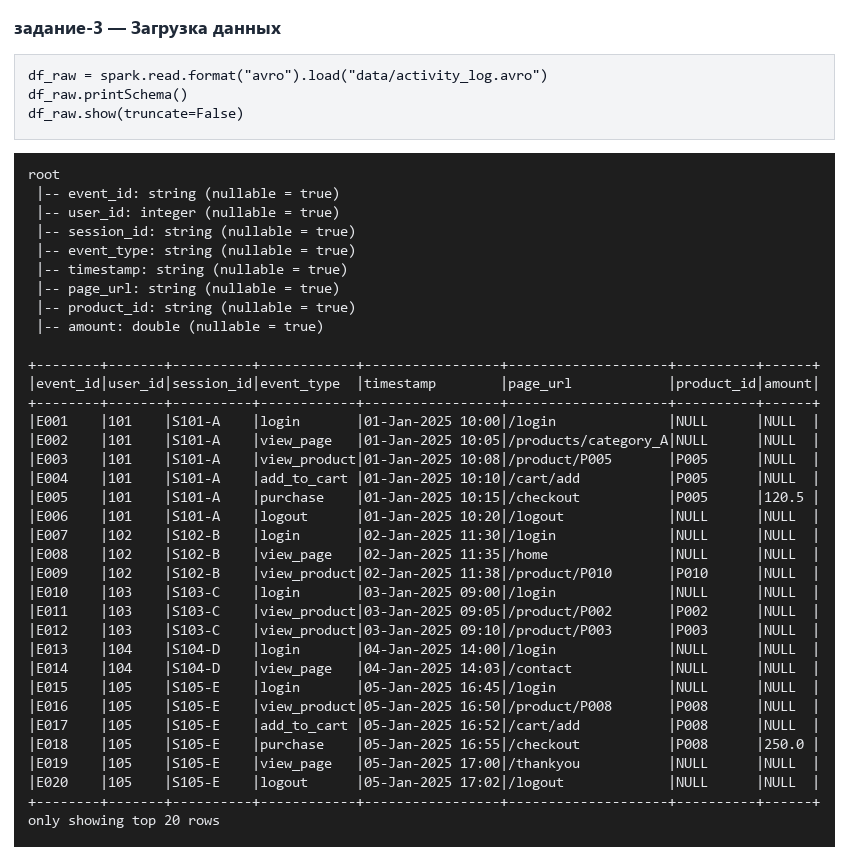
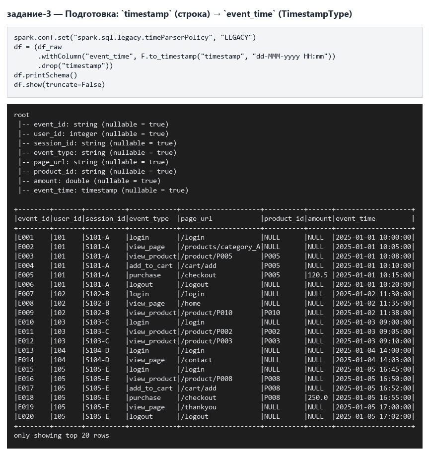
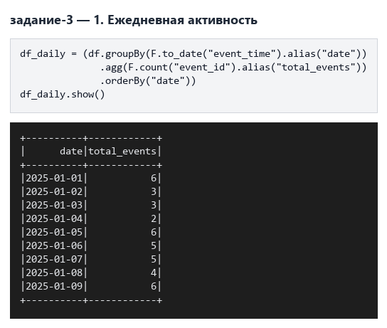
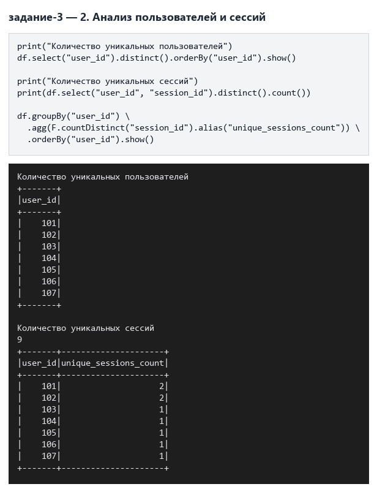
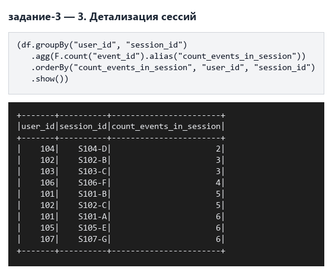
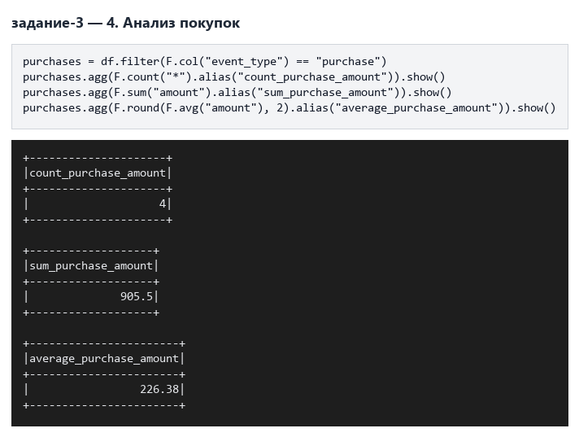
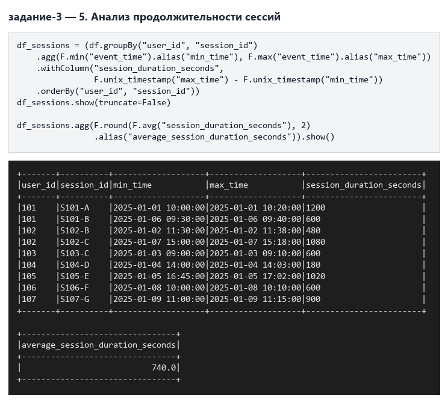

# 1 срез. Самостоятельное задание №3: пользовательские сессии (AVRO)

Вариант 3 выбран по правилу «родился летом».

Файлы:
- `zadanie-3.ipynb` — решение;
- `zadanie-3.html` — ноутбук с выводами;
- `data/activity_log.avro` — исходные данные.

## Что сделано
1. **Загрузка данных.** AVRO-файл читается через `spark.read.format("avro")`.
2. **Подготовка времени.** Строка `timestamp` в формате `01-Jan-2025 10:00` переводится в `event_time` типа `TimestampType` через `to_timestamp(..., "dd-MMM-yyyy HH:mm")`.
3. **Ежедневная активность.** Число событий по дням считается через `groupBy(to_date(event_time))`.
4. **Пользователи и сессии.** Найдено 7 уникальных пользователей и 9 уникальных сессий. Также посчитано число сессий на каждого пользователя.
5. **Детализация сессий.** Посчитано число событий в каждой сессии.
6. **Покупки.** Всего 4 покупки на сумму 905.5, средний чек 226.38.
7. **Продолжительность сессий.** Длительность считается как `max(event_time) − min(event_time)` внутри сессии. Средняя длительность — 740 секунд.

## Скриншоты работы
### Загрузка данных

### Преобразование timestamp → event_time

### 1. Ежедневная активность

### 2. Пользователи и сессии

### 3. Детализация сессий

### 4. Анализ покупок

### 5. Продолжительность сессий

