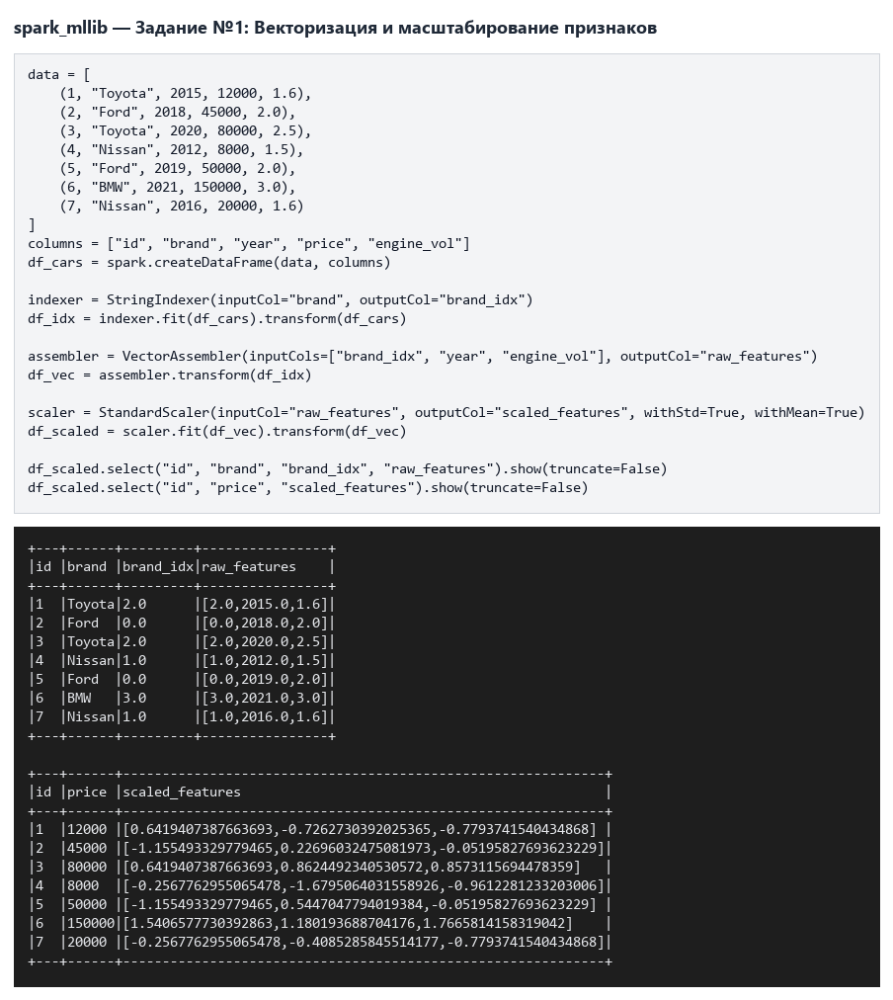
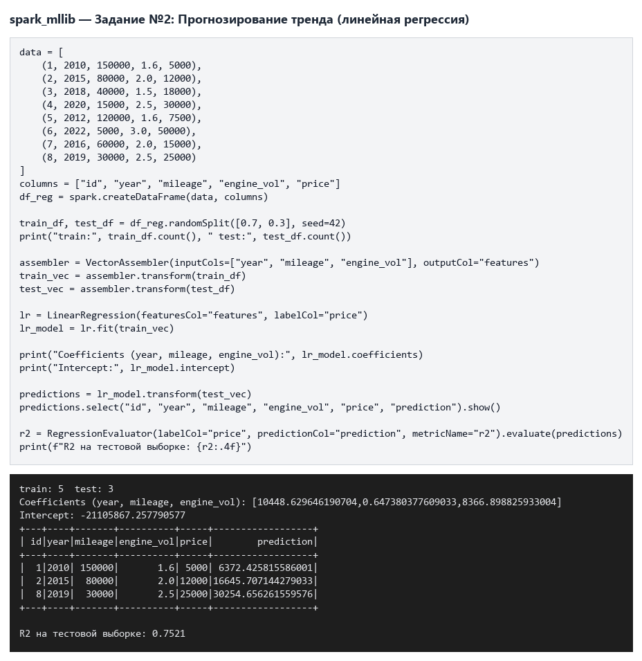
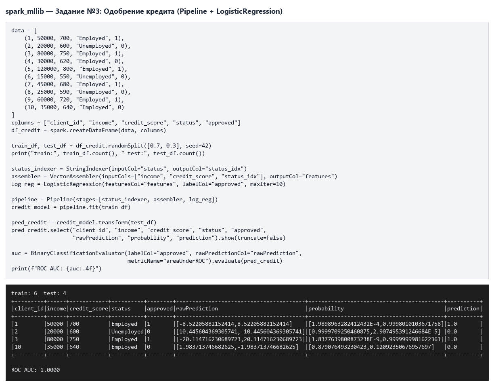
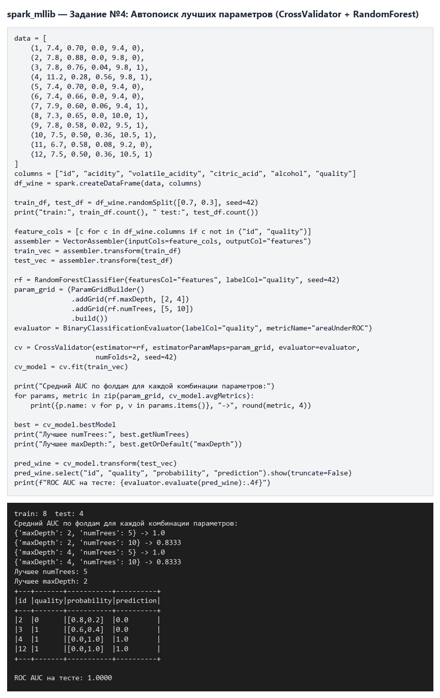
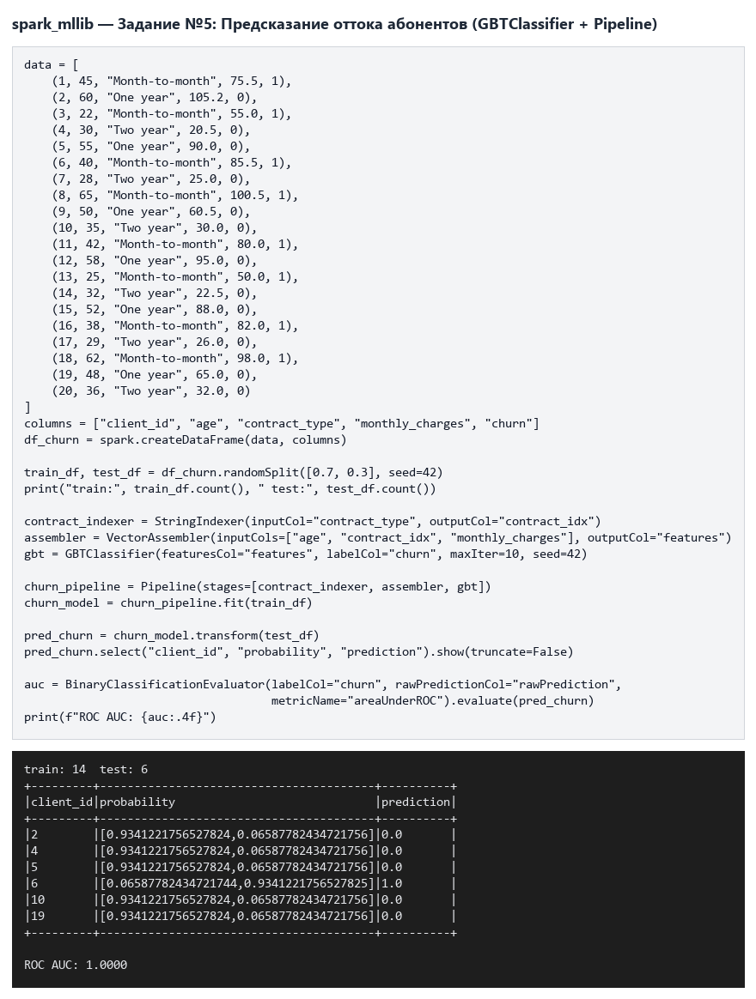

# 2 срез. Самостоятельная работа по Spark MLlib

Файлы:
- `spark_mllib.ipynb` — решение;
- `spark_mllib.html` — ноутбук с выводами.

Датасеты создаются прямо в коде.

| № | Задание | Что сделано | Результат |
|---|---|---|---|
| 1 | Векторизация и масштабирование | `StringIndexer(brand)`, затем `VectorAssembler(brand_idx, year, engine_vol)`, затем `StandardScaler(withMean, withStd)` | выведены `id`, `price`, `scaled_features` |
| 2 | Линейная регрессия | разбиение 70/30 (seed=42), `VectorAssembler(year, mileage, engine_vol)` и `LinearRegression` | **R² = 0.7521** |
| 3 | Одобрение кредита | `Pipeline(StringIndexer, VectorAssembler, LogisticRegression(maxIter=10))` | **ROC AUC = 1.0** |
| 4 | CrossValidator | `RandomForestClassifier`, сетка maxDepth {2, 4} × numTrees {5, 10}, `numFolds=2` | лучшая модель: **numTrees=5, maxDepth=2** |
| 5 | Отток абонентов | `Pipeline(StringIndexer, VectorAssembler, GBTClassifier(maxIter=10))` | **ROC AUC = 1.0** |

В датасетах от 7 до 20 строк, поэтому метрики на тесте близки к 1.0 и о качестве моделей почти ничего не говорят.

## Скриншоты работы
### Задание 1. Векторизация и масштабирование

### Задание 2. Линейная регрессия

### Задание 3. Одобрение кредита

### Задание 4. CrossValidator

### Задание 5. Отток абонентов (GBT)

